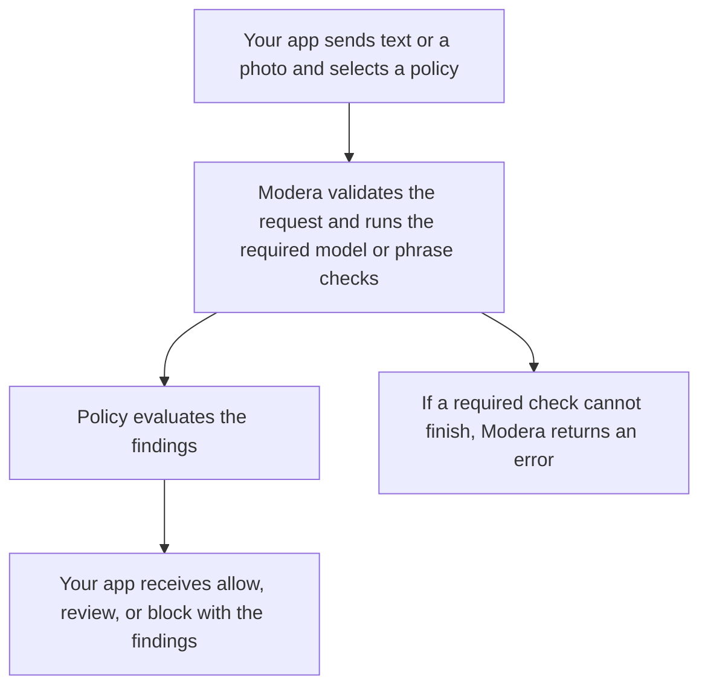

# Modera

[](https://github.com/Isafatokun/modera/actions/workflows/ci.yml)

An experimental, self-hosted, policy-driven moderation API for text and photos.

You send one item and name a policy. Modera runs the checks that policy needs and
returns `allow`, `review` or `block`, with the scores behind the decision. The models
detect, the policy decides, and your application acts. Two products can use the same
models and treat the findings differently.

Start with phrase rules, then configure compatible models, label mappings, and
policies for your product. Supporting a new model type requires code.

**Status: experimental.** On two public labelled text datasets, none of the six models
tested catches 90% of toxic text at 5% false flags. The best catch 32% (French) and 48%
(English) at about 5%. See [accuracy](docs/accuracy.md). Photo accuracy is unmeasured,
and no product uses Modera yet.

## How it works



Your app owns publication and human review. If a request fails, the app can keep
the content pending and use the [error details](docs/api.md#errors) to decide whether
to retry.

## Quick start

You need Python 3.12 and [uv](https://docs.astral.sh/uv/getting-started/installation/).
This demo matches literal phrases and downloads no model.

```sh
uv sync --locked
export MODERA_API_KEY="$(openssl rand -hex 32)"
MODERA_POLICY_FILE=examples/policies.json \
MODERA_TEXT_RULES_FILE=examples/text-rules.json \
uv run --locked uvicorn modera.main:create_app --factory
```

In another shell with the same key:

```sh
curl http://127.0.0.1:8000/v1/moderations \
  -H "Authorization: Bearer $MODERA_API_KEY" -H 'Content-Type: application/json' \
  -d '{"input":{"type":"text","text":"example prohibited phrase"},"policy":"rules-only"}'
```

```json
{
  "request_id": "req_edca92b36b904b4a90c73edbc4b525e8",
  "input_type": "text",
  "policy": {"id": "rules-only", "version": "1"},
  "decision": {"action": "block", "reasons": ["rules.prohibited_terms"]},
  "findings": [{"category": "rules.prohibited_terms", "score": 1.0, "source": "rules"}],
  "coverage": {"evaluated": ["rules.prohibited_terms"], "unsupported": [], "not_applicable": []},
  "models": [],
  "rules_version": "1",
  "fallback": false,
  "preprocessing_version": "text-v1.5362714a..."
}
```

## Real models

Prepare the pinned weights once, then start the service with a model file:

```sh
uv sync --locked --extra inference
uv run --locked --extra inference python -m modera.prepare_models --config examples/models.json
export MODERA_API_KEY="$(openssl rand -hex 32)"
export MODERA_MODEL_FILE=examples/models.json
export MODERA_POLICY_FILE=examples/policies.json
uv run --locked --extra inference uvicorn modera.main:create_app --factory
```

Upload a photo with `curl ... -F 'file=@photo.jpg'` against the same endpoint. The
example models and thresholds are placeholders. See [models](docs/models.md).

## What it does

- Takes text, a photo upload, or an HTTPS photo URL from hosts you allow.
- Applies named, versioned [policies](docs/policies.md): thresholds, required checks, and
  rules that combine several photo models.
- Reports what it evaluated. A check that did not finish is an error, never an `allow`.
- Runs pinned local models on CPU, loaded offline. Content stays in your deployment.
- Exposes health checks and Prometheus metrics, bounds its queues, and drains on shutdown.

It does not publish content, keep a review queue or store results. Your application owns
those, and a retry is a new evaluation. [`examples/upload_gate.py`](examples/upload_gate.py)
shows an upload that stays private until a completed decision arrives. A
[Go client](clients/go/README.md) is included.

## Why not a hosted API?

Hosted services such as [OpenAI's moderation endpoint](https://developers.openai.com/api/docs/guides/moderation)
and [AWS Rekognition](https://docs.aws.amazon.com/rekognition/latest/APIReference/API_DetectModerationLabels.html)
return scores or labels, and your content goes to the provider. Modera keeps content in
your deployment and makes the decision a versioned, testable policy. The price is that you
run the models and measure their accuracy yourself.

## Documentation

| | |
| --- | --- |
| [API](docs/api.md) | Requests, results, errors, and how to act on them |
| [Configuration](docs/configuration.md) | Every setting |
| [Policies](docs/policies.md) | Thresholds and required checks |
| [Models](docs/models.md) | Preparing and replacing models, text rules and fallback |
| [Photo models](docs/image-models.md) | Detectors, ONNX, and combining models |
| [Operations](docs/operations.md) | Metrics, overload, shutdown, key rotation, troubleshooting |
| [Design](docs/design.md) | Why it is built this way, and the trade-offs |
| [Accuracy](docs/accuracy.md) | Measured text accuracy |

## Development

```sh
uv sync --locked
uv run --locked ruff check . && uv run --locked ruff format --check .
uv run --locked mypy
uv run --locked pytest
```

Over 500 tests call the API in process. The Go client has unit tests only. Not covered:
photo accuracy, real-model speed, your load balancer, and production capacity. See
[CONTRIBUTING](CONTRIBUTING.md) and [SECURITY](SECURITY.md).

## Licence

Apache-2.0, see [LICENSE](LICENSE). Model weights have their own terms; check them
before you deploy a model.
