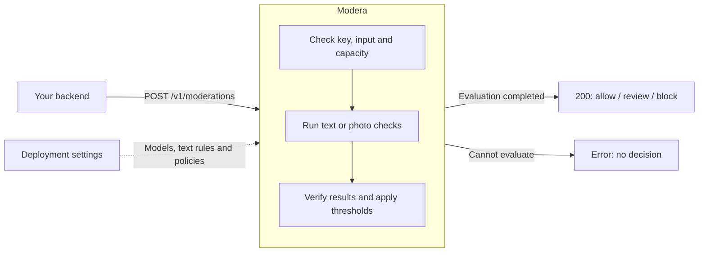

# Modera

Text and photo moderation service.

A synchronous API with replaceable text/photo classifiers, configurable policies,
optional text rules, and explicit failure handling. Models and policies are operator
configured; an unconfigured modality returns `501`.

New here? [Start here](docs/start-here.md) for the rules demo, real-model setup
and troubleshooting.

## How it works

Send text, a photo upload or an allowed HTTPS photo URL to
`POST /v1/moderations` with a bearer key and a policy name. Your deployment
configures the models, optional text rules and policy thresholds.



The response includes reasons, category scores, coverage, the policy/model
versions actually used, and a request ID. **Your application** publishes, holds
for review or rejects content; Modera does not perform those actions or store a
review queue. An error is not an allow decision, and `allow` covers only the
configured checks.

See [how to use the result](docs/how-it-works.md) for the request flow,
configuration choices, fallback and retry behavior.

## Run

Requires Python 3.12 and [uv](https://docs.astral.sh/uv/getting-started/installation/).

```sh
uv sync --locked
export MODERA_API_KEY="$(uv run --locked python -c 'import secrets; print(secrets.token_urlsafe(32))')"
MODERA_POLICY_FILE=examples/policies.json \
MODERA_TEXT_RULES_FILE=examples/text-rules.json \
uv run --locked uvicorn modera.main:create_app --factory --reload
```

The server binds to localhost. Use `--reload` only for development. This example
enables literal text rules; it does not load a model. In another shell with the
same API key, this returns `block`:

```sh
curl http://127.0.0.1:8000/v1/moderations \
  -H "Authorization: Bearer $MODERA_API_KEY" -H 'Content-Type: application/json' \
  -d '{"input":{"type":"text","text":"example prohibited phrase"},"policy":"rules-only"}'
```

## Configuration

| Variable | Default | Purpose |
| --- | --- | --- |
| `MODERA_API_KEY` | Required | Shared bearer API key; 32–512 printable ASCII characters, no spaces |
| `MODERA_PREVIOUS_API_KEY` | Unset | Optional previous bearer key accepted during a bounded rotation window |
| `MODERA_MAX_IN_FLIGHT_REQUESTS` | `8` | Maximum active HTTP moderation requests per process; excess requests rejected immediately |
| `MODERA_IMAGE_QUEUE_SIZE` | `5` | Waiting photo jobs per processing stage; `0` rejects immediately when busy |
| `MODERA_IMAGE_QUEUE_WAIT_SECONDS` | `2` | Maximum photo queue wait, within each stage's deadline |
| `MODERA_DOCS_ENABLED` | `false` | Enable `/docs` and `/openapi.json` |
| `MODERA_POLICY_FILE` | Unset | Path to a validated policy JSON file |
| `MODERA_MODEL_FILE` | Unset | Text/photo model configuration; alternative to individual model settings |
| `MODERA_TEXT_MODEL__ID` / `__REVISION` | Unset | Text model ID and full commit SHA |
| `MODERA_IMAGE_MODEL__ID` / `__REVISION` | Unset | Photo model ID and full commit SHA |
| `MODERA_IMAGE_ALLOWED_HOSTS` | `[]` | JSON array of exact DNS hostnames allowed for image downloads |

Set variables through the shell or your deployment's secret manager. `.env` files
are not loaded automatically. Missing/invalid keys and invalid policy files prevent
startup. Generate a random key for each deployment; never commit it or embed it in
browser/mobile code. Use HTTPS at the deployment ingress. For rotation, see the [three-step key rotation guide](docs/operations.md#rotate-the-api-key).

Model selections default to unset. Configure repository ID, pinned revision and label
mapping; see [models, replacement, and rules fallback](docs/models.md). Classifier
weights must be prepared before startup. Rules-only deployments need no ML packages.

## API

`POST /v1/moderations` requires `Authorization: Bearer <key>`. It accepts JSON text,
a JSON image URL, or a multipart image file. See [requests, results, and errors](docs/api.md).

[Policies](docs/policies.md) control category thresholds and required checks. No
thresholds are installed by default. URL retrieval requires an explicit host allowlist.

Health checks need no credentials: `/health/live` checks HTTP availability;
`/health/ready` checks readiness for the configured model/rules mode. Successful checks return
`{"status":"ok"}`. Every application HTTP response includes `X-Request-ID`.

`GET /metrics` exposes Prometheus request counts, latency, policy decisions, category
scores, worker occupancy and queue depths. It requires the same bearer key. See [operations](docs/operations.md) for deployment
and overload behavior.

## Container

For working text/photo models, preparation and request checks, use the
[Docker Compose reference setup](deploy/reference/README.md).

```sh
docker build -t modera:local .
docker run --rm --init --read-only --cap-drop=ALL \
  --security-opt=no-new-privileges --tmpfs /tmp -e MODERA_API_KEY \
  -p 127.0.0.1:8000:8000 modera:local
```

Runs as a non-root user with runtime dependencies only. Access logging and proxy
header trust are disabled. Mount policy files read-only when configured.

## Development

```sh
uv run --locked ruff check .
uv run --locked ruff format --check .
uv run --locked mypy
uv run --locked pytest
uv build
```

Code: `src/modera/`. Tests: `tests/unit/`, `tests/integration/`.
Optional [capacity benchmarks](benchmarks/README.md) run with real models.
See [quality evaluation](evaluation/README.md) for reproducible classifier comparisons.
Dependencies: `pyproject.toml` and `uv.lock`.

## Integrations and review

The [Go client](clients/go/README.md) supports text, image URLs and uploads with
context deadlines, bounded retries, typed results and explicit fallback provenance.
It has no third-party dependencies.

The [category review workflow](evaluation/review.md) creates blinded review packets,
tracks disagreements, preserves uncertainty and exports sealed calibration/test
labels. Its example inputs are synthetic; it does not supply independent human
validation or select a production model automatically.

For a runnable application using the SDK, see the
[Go integration example](clients/go/cmd/moderate/README.md). It demonstrates
publish/review/reject/pending handling, photo inputs, deadlines and safe error output.

## Roadmap

Additional inference adapters, other client SDKs,
and durable asynchronous moderation jobs.
