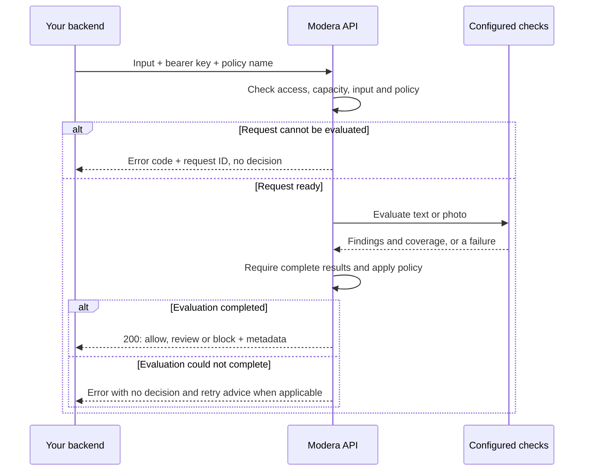

# How Modera fits into your application

Your backend sends one piece of text or one photo to Modera. Modera runs the
configured checks, applies the selected policy and returns a decision with the
information needed to interpret it. Your application decides whether to publish,
hold for review or reject the content.

Modera is a synchronous service: it replies within the same request. It does not
publish content, create review cases, or keep a durable job/result store.

## Send an input and choose a policy

All three input forms use `POST /v1/moderations` with a bearer API key. Keep that
key in your backend, not in a browser or mobile client.

| What you send | Request form | What Modera does |
| --- | --- | --- |
| Text | JSON with `input.type: text` and `input.text` | Validates the text and evaluates configured text checks. |
| Photo bytes | Multipart `file` upload | Decodes and prepares a supported still photo before evaluating photo checks. |
| Photo URL | JSON with `input.type: image` and an HTTPS URL source | Fetches from an explicitly allowed host, then handles the bytes like an upload. |

Photo URLs are disabled until the operator configures an exact host allowlist.
URL retrieval adds a dependency on the media host; upload directly if your backend
already has the bytes. See [request examples and limits](api.md#requests).

The `policy` field selects an operator-defined policy, defaulting to the name
`default`. That name does not install a model or thresholds automatically. The
operator must configure policies and the checks they need before use.

## From request to response

The diagram groups validation and media preparation to keep the caller's flow
readable. Photo URL fetching and photo decoding happen before model inference.
Authentication and request admission happen before body processing.

Only models needed by the selected policy run. Configured text rules can evaluate
literal phrases without an ML model. Scores are associated with category names;
the policy defines which categories are required and which score thresholds mean
review or block. A block threshold takes precedence over a review threshold.
Missing required support or results produces an error, not an allow decision.
See [policies](policies.md) and [model/rule configuration](models.md).

Operators prepare and load pinned model versions before serving. Models are
reused across requests; they are not downloaded for each API call. No particular
classifier or universal safety policy is selected automatically.

## Interpret the outcome

A `200` means an evaluation completed; it does not mean the content was allowed.

| Response | Meaning | What your application can do |
| --- | --- | --- |
| `200` + `allow` | The configured policy's checks passed. | Continue the application's publication flow if that meets its policy. |
| `200` + `review` | A review threshold was reached. | Keep content unpublished and create a review case in your application. |
| `200` + `block` | A block threshold was reached. | Reject the content according to your application's rules. |
| Error response | No moderation decision is available. | Keep content pending; fix the request/configuration or retry when appropriate. |

An allow covers only the configured checks. It is not a claim that all possible
safety categories were assessed. The service reports what it evaluated so callers
can make that distinction.

Successful results include:

- `decision.action` and `decision.reasons`: the action and triggering categories.
- `findings` and `coverage`: category scores, their model/rules source, and which
  categories were evaluated, unsupported or not applicable.
- `policy`, `models`, `rules_version` and `preprocessing_version`: the policy and
  processing configuration actually used.
- `request_id`: a correlation identifier for that evaluation.

See the [full response example](api.md#moderation-result). Scores are model
outputs, not guaranteed probabilities or interchangeable values across models.

Text fallback is optional and explicitly configured. A successful reduced
rules-only evaluation returns `fallback: true` with the actual policy and coverage;
it does not claim that unavailable model checks completed. Your application
should decide how to handle reduced coverage. The
[Go example](../clients/go/cmd/moderate/README.md) sends fallback allows to review
and keeps fallback blocks rejected.

## When a check cannot finish

Busy capacity, unavailable checks and some media-source failures may be retryable.
Inspect the structured `error.code` and `error.retryable`; respect `Retry-After`
when present and keep retries within an overall deadline. Authentication, invalid
input and missing backend configuration require a different fix. See
[error codes and retry semantics](api.md#errors).

If the client times out or receives no valid response, keep the result pending
too; do not infer an allow from the absence of an error body.

A retry is a new evaluation with a new request ID. Modera does not deduplicate
requests or replay stored results. Your application owns the idempotency of later
business actions, such as creating review cases or publishing content. Deduplicate
those actions using your application's content ID, not Modera's per-request ID.

Submitted media and decisions are not stored as durable assets/results. In-flight
work is process-local and does not survive restart. For queues, concurrency,
metrics, shutdown and scale-out concerns, see [operations](operations.md).

## Start integrating

Start with the [API request examples](api.md#requests), or use the
[Go SDK](../clients/go/README.md) and its
[runnable application example](../clients/go/cmd/moderate/README.md). For a
ready-to-run configuration with real text/photo models, use the
[reference deployment](../deploy/reference/README.md); its model thresholds remain
experimental and require independent quality validation for your content.
