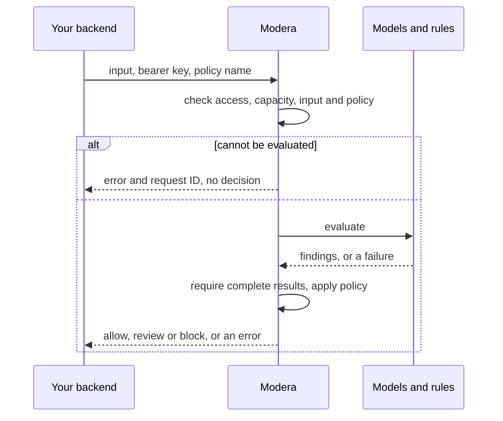

# How it works

Your backend sends one piece of text or one photo to Modera. Modera runs the checks
the selected policy needs and returns a decision with the evidence behind it. Your
application decides what to do next. Modera replies within the same request. It does
not publish content, open review cases or store anything.

## A request

All inputs go to `POST /v1/moderations` with a bearer key, which belongs in your
backend and never in a browser or mobile client.

| Input | Request |
| --- | --- |
| Text | JSON with `input.type` `text` and `input.text` |
| Photo bytes | Multipart upload in `file` |
| Photo URL | JSON with `input.type` `image` and an HTTPS URL. Needs an [allowlisted host](configuration.md). Uploading avoids the dependency on the media host. |

The `policy` field names a policy the operator defined; it defaults to `default`.
See [API](api.md#requests) for examples and limits.

Only the models the policy needs run. Text rules can match literal phrases without a
model. The policy says which categories are required and which scores mean review or
block, and block wins over review. If a required check is unsupported or its result is
missing, the response is an error and never an allow. See [policies](policies.md) and
[models](models.md).

## Reading the outcome

A `200` means the evaluation completed, not that the content was allowed.

| Response | Meaning |
| --- | --- |
| `200` `allow` | No configured check reached a threshold. |
| `200` `review` | A review threshold was reached. Hold the content and open a review case in your application. |
| `200` `block` | A block threshold was reached. Reject the content. |
| error | There is no decision. Keep the content pending, fix the request or retry. |

An `allow` covers only the configured checks. The result lists what ran:

- `decision`: the action and the categories that triggered it.
- `findings` and `coverage`: scores with their source, and which categories were
  evaluated, unsupported or not applicable.
- `policy`, `models`, `rules_version`, `preprocessing_version`: the configuration
  actually used.
- `request_id`: identifies this evaluation.

Scores are model outputs, not probabilities, and are not comparable across models.
The [API page](api.md#moderation-result) has a full example.

Text fallback is optional. When it applies, the result has `fallback: true` and the
policy and coverage of the reduced rules-only evaluation. Decide how your
application treats reduced coverage; the [Go example](../clients/go/cmd/moderate/README.md)
sends a fallback `allow` to review and keeps a fallback `block` rejected.

## Failures and retries

Check `error.code` and `error.retryable`. Retry only retryable errors, honour
`Retry-After`, and stay inside an overall deadline. Authentication, invalid input and a
missing backend need a different fix. See [errors](api.md#errors).

If the client times out or gets no valid response, treat the content as pending.

A retry is a new evaluation with a new request ID. Modera does not deduplicate
requests or replay results, so make your own follow-up actions (publishing, opening a
review case) idempotent, keyed on your content ID and not on Modera's request ID.
In-flight work lives in the process and is lost on restart. See
[operations](operations.md) for queues, metrics and shutdown.

To integrate, use the [Go client](../clients/go/README.md) or the
[reference deployment](../deploy/reference/README.md). The reference thresholds are
experimental; validate them on your own content first.
